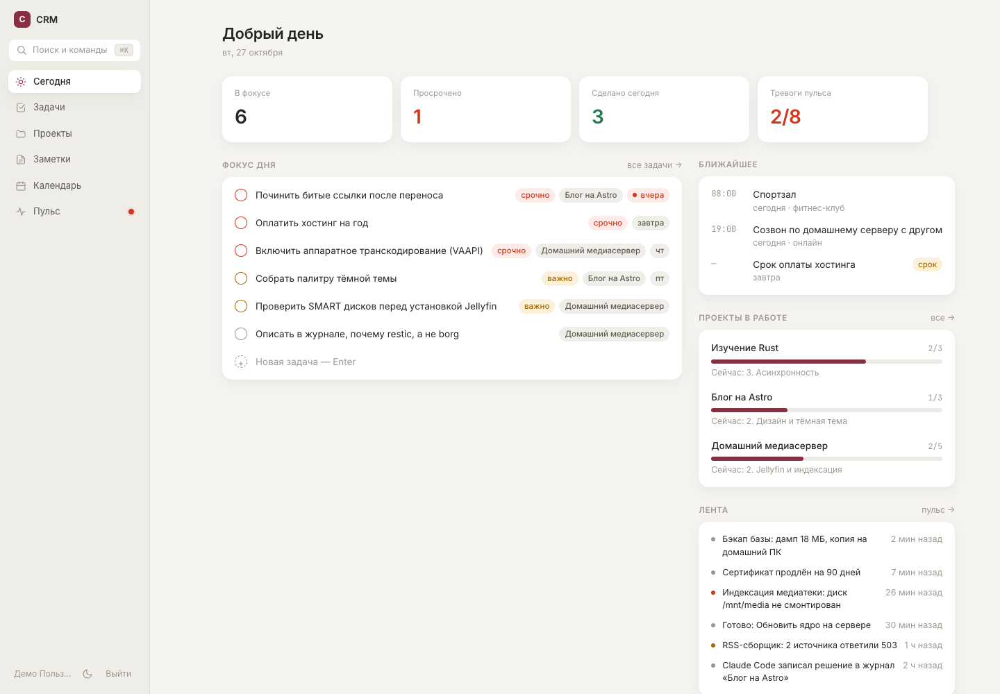
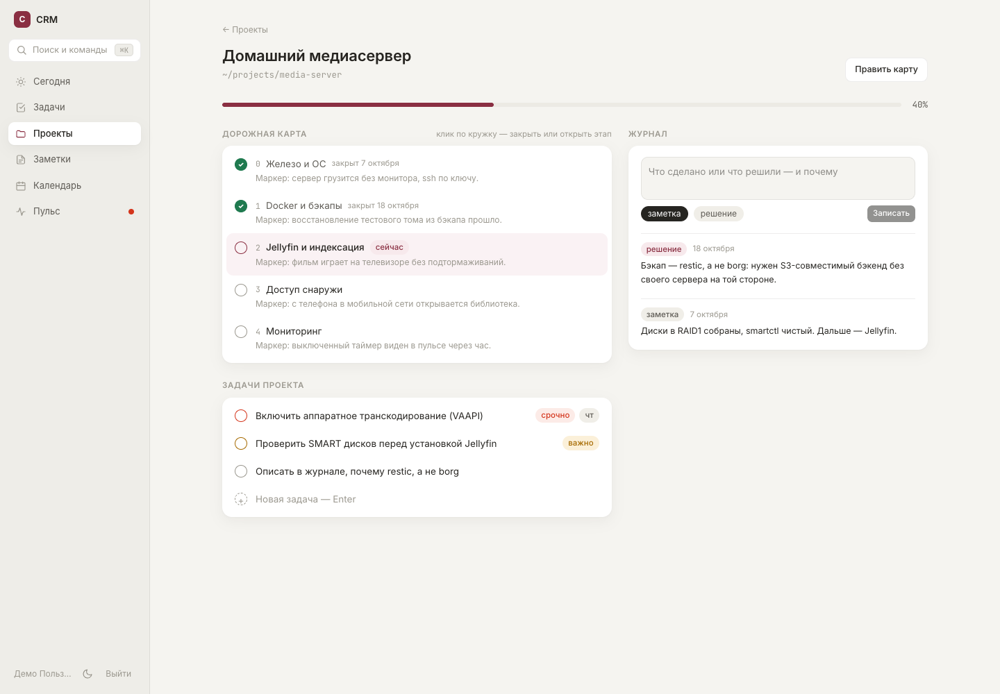
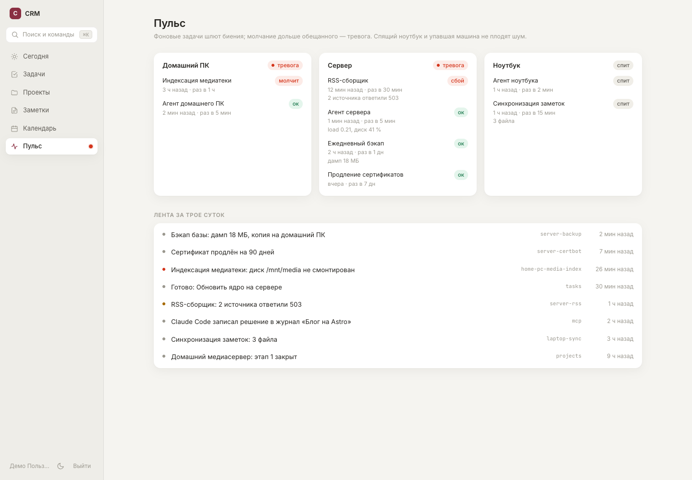
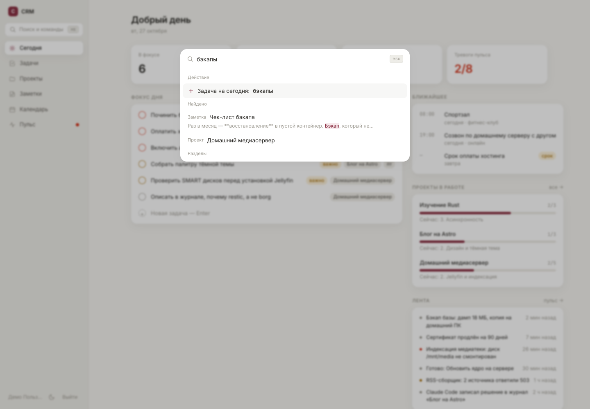

# Personal CRM — витрина

Личная CRM, которой я пользуюсь каждый день: задачи и план дня, проекты с дорожными картами, заметки,
календарь, лента событий и «пульс» фоновых задач на трёх машинах. Это обезличенная витрина: ядро backend,
несколько модулей, SPA и MCP-сервер, собранные из приватной системы и запускаемые одной командой
на вымышленных данных.



## Запуск

```sh
./scripts/init-secrets.sh          # случайные пароль Postgres и ключ JWT в ./secrets (значения не печатаются)
docker compose up --build          # http://localhost:8080, вход: demo@example.com / demo
```

База заполняется демо-данными при первом старте. Документация API — `http://localhost:8080/api/docs`
(включена переменной `API_DOCS=1`).

## Что внутри

| Часть | Стек | Где |
|---|---|---|
| API | Python 3.12, FastAPI, SQLModel, Alembic, PostgreSQL 17, JWT + argon2 | `backend/` |
| SPA | React 19, TypeScript, TanStack Router + Query, Tailwind 4, cmdk, Vite | `web/` |
| MCP-сервер | Python, `mcp` SDK, httpx | `mcp/crm_mcp.py` |
| Деплой | Docker Compose, nginx, systemd-таймер бэкапа, smoke-проверка | `docker-compose.yml`, `deploy/` |

### Экраны

- **Сегодня** — фокус дня, просрочки, ближайшие события, проекты в работе, тревоги пульса и лента — одним запросом.
- **Задачи** — сегодня / впереди / входящие / все / сделано, быстрый ввод, приоритеты и сроки.
- **Проекты** — прогресс по дорожной карте, текущий этап, журнал решений, правка карты прямо в интерфейсе.
- **Заметки** — Markdown с автосохранением, теги, закреплённые.
- **Календарь** — неделя: события и сроки задач на одной сетке.
- **Пульс** — состояние фоновых задач по машинам и общая лента событий.
- **⌘K** — палитра: переход по разделам, полнотекстовый поиск по всему и быстрая задача; `g` + буква — переход с клавиатуры.

| Проект | Пульс | Палитра |
|---|---|---|
|  |  |  |

## Архитектура

```
браузер ──► web (nginx: SPA + /api) ──► api (FastAPI) ──► postgres
                                           ▲
скрипты, таймеры, мосты ── X-API-Key ──────┤   POST /api/v2/feed/beat, /feed/event
Claude Code ── MCP (stdio) ── crm_mcp.py ──┘   задачи, журнал проекта, закрытие этапов
```

- **Слой `/api/v2` из подключаемых модулей.** Каждый модуль экспортирует `router`; список имён — в
  `backend/app/v2/__init__.py`. В приватной версии так подключено около девяноста модулей, и их можно
  разрабатывать параллельно, не трогая общий файл маршрутов.
- **Три способа входа, одна модель прав.** Bearer-токен, httpOnly-кука для SPA и `X-API-Key` для скриптов.
  Роли — набор прав (`owner`, `viewer`, `agent`, `bridge`); у MCP-ключа роль `agent`: читает всё, пишет задачи
  и журналы, но не управляет ключами. Пароли — argon2, ключи — sha256 (ключ — 32 случайных байта,
  медленный хэш не нужен, а поиск идёт по индексу). Ключ показывается один раз.
- **Секреты — файлами.** `PG_PASSWORD_FILE`, `JWT_SECRET_FILE` → compose secrets: переменные окружения видны
  в `docker inspect`, файлы — нет.
- **Читаемые идентификаторы** (`tsk-000042`, `prj-000003`): номер выдаётся под `pg_advisory_xact_lock`, а номер
  удалённого объекта не переиспользуется — иначе ссылка из истории открыла бы чужой объект (`db.next_id`).
- **Кэш, который сбрасывается сам.** Сводка «Сегодня» кэшируется в процессе, а любой COMMIT с реальной записью
  сдвигает «поколение» — кэш устаревает без ручной инвалидации (`db.cached`).
- **Полнотекстовый поиск** Postgres с русской морфологией («бэкапы» находит «бэкап»), GIN-индексы и
  подсветка совпадений `ts_headline`.

### Проекты: файл — источник правды

Проект — это папка со спецификацией, дорожной картой и журналом. CRM не заставляет вести карту в своём
формате: `backend/app/roadmap.py` разбирает четыре формы, в которых карты пишутся на практике (чекбоксы с
жирным «Этап N», заголовки `## Этап N`, таблицы со столбцом «Готово, когда», простые чекбоксы), находит
маркер готовности и пометку «заморожен». Закрыть этап — значит поправить сам текст карты
(`- [ ]` → `- [x]` и «(закрыт ДД.ММ.ГГГГ)») с сохранением формы записи и переводов строк; таблица `stages`
в базе — только кэш разбора.

### MCP: Claude Code пишет в CRM сам

`mcp/crm_mcp.py` даёт агенту инструменты `today`, `tasks`, `add_task`, `complete_task`, `projects`, `project`,
`project_journal`, `project_stage`, `search`, `pulse`. Сценарий: сессия работает в папке проекта, по ходу
записывает решения с причинами в журнал и закрывает этапы; сервер правит текст карты, клиент кладёт его
обратно в файл на диске. Следующая сессия начинает с чтения карты и журнала, а не с расспросов.

```sh
claude mcp add crm -e CRM_URL=http://localhost:8080 -e CRM_KEY=<ключ> -- python3 mcp/crm_mcp.py
```

Ключ: `DEMO_API_KEY` из `.env` (его создаёт `scripts/init-secrets.sh`) или `POST /api/v2/auth/keys` от владельца.

### Пульс фоновых задач

Каждый таймер в конце работы шлёт биение: «жив, статус такой-то, жди меня через N секунд»
(`deploy/backup.sh` — пример). Пульс (`backend/app/pulse.py`, чистая функция) считает тревогой молчание дольше
1,5 обещанного интервала и сбои, но не шумит там, где шуметь не нужно:

- ноутбук, молчащий дольше пяти минут, спит — его задачи не тревога;
- если молчит сама машина, тревога одна — по машине, а не по каждой её задаче;
- выключенную намеренно задачу можно заглушить, чтобы она не висела в тревогах вечно.

## Тесты

```sh
cd backend && pip install -r requirements-dev.txt
pytest -q                                              # чистые функции: разбор карт, правка карт, пульс
CRM_URL=http://localhost:8080 CRM_KEY=<ключ> pytest -q # плюс сквозные проверки живого API
sh deploy/smoke.sh http://localhost:8080               # health, SPA, закрытый API
```

Тесты чистых функций прогоняются и при сборке образа: упали — образ не собирается, а работающий контейнер
остаётся на месте.

## Что умеет полная приватная версия

Витрина — примерно двадцатая часть системы. В приватной версии на том же ядре работают:

- учёт финансов: счета, операции, бюджет, импорт банковских уведомлений, прогноз;
- конвейер контента для соцсетей: от замысла и текста до визуала, публикации и статистики по площадкам;
- приём сообщений и созвонов из мессенджеров в единую ленту с расшифровкой голосовых и поиском;
- учебный контур: задания и сроки из LMS, расписание;
- «Офис»: очередь задач, которые исполняют раннеры на трёх машинах (VPS, домашний сервер, ноутбук), запуская
  Claude Code или Codex и возвращая результат;
- цели и недельные метрики, база знаний, общий доступ для приглашённых людей по ролям;
- отдельный сервис авторизации («Паспорт»: RS256 + JWKS, вход через Telegram), ~200 миграций Alembic,
  ~120 файлов тестов, ежедневные шифрованные бэкапы с забором на домашний сервер.

Чего здесь нет намеренно: реальных данных, интеграций с личными аккаунтами и модулей, завязанных на конкретных людей.

## Структура

```
backend/app/        config, db (кэш поколений, next_id), auth, models, roadmap, pulse, seed
backend/app/v2/     health, auth, today, tasks, projects, notes, calendar, feed, search
backend/alembic/    миграции
backend/tests/      тесты чистых функций и сквозной смоук API
web/src/            layout (Shell, палитра), screens, api (клиент, хуки, типы), ui
mcp/                MCP-сервер
deploy/             бэкап + systemd-таймер, внешний nginx, smoke
```

## Лицензия

MIT — см. `LICENSE`.
